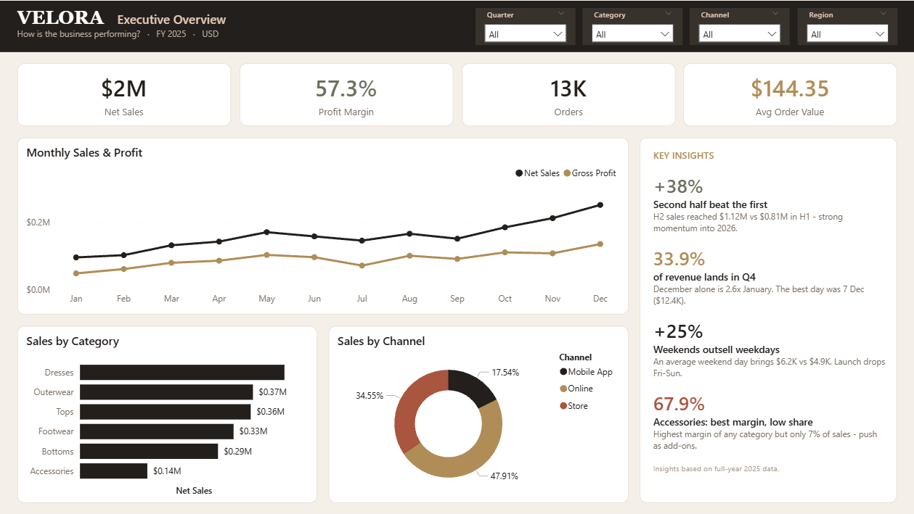
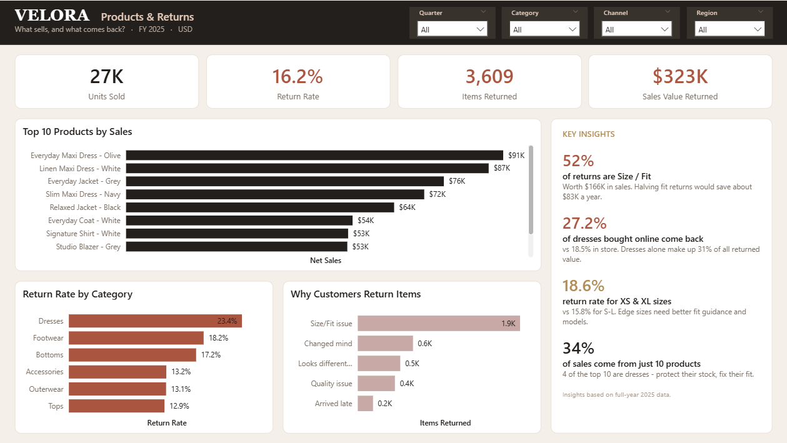
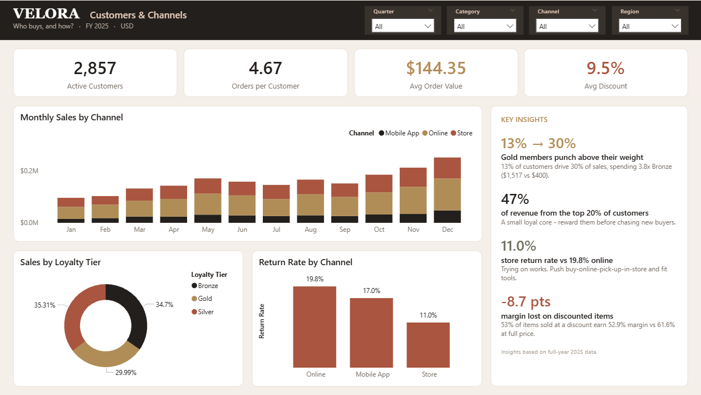

# Velora Fashion: Sales & Returns Analysis (Power BI)

A data analyst portfolio project that analyses one year (FY 2025) of sales for **Velora**, a fictional mid-range fashion brand that sells online, in stores and through a mobile app.

**Tools:** Python (pandas, NumPy) · Power BI Desktop (Power Query, DAX, star-schema data model)

📥 **[Download the dashboard (.pbix)](Velora_Sales_Dashboard.pbix)** and open it in Power BI Desktop.

---

## Dashboard

### 1. Executive Overview: *How is the business performing?*


### 2. Products & Returns: *What sells, and what comes back?*


### 3. Customers & Channels: *Who buys, and how?*


Every page has **Quarter, Category, Channel and Region** filters. They are synced, so a filter set on one page applies to all pages. Each page also has a **Key Insights** panel with four findings backed by the data.

---

## Business questions
1. How are sales and profit trending month by month, and when are the peak seasons?
2. Which categories and products drive revenue, and which ones get returned the most?
3. How do the sales channels compare on revenue and return rate?
4. Who are the customers by age, region and loyalty tier?
5. How much do discounts reduce profit margin?

## Headline numbers
| Net Sales | Gross Profit | Profit Margin | Orders | Avg Order Value | Return Rate | Active Customers |
|---|---|---|---|---|---|---|
| **$1.93M** | **$1.10M** | **57.3%** | **13,347** | **$144.35** | **16.2%** | **2,857** |

## Key insights
1. **Q4 brings in a third of the year's revenue.** October to December account for 33.9% of sales. December ($253K) is 2.6× January ($97K), and the second half of the year beat the first by 38%.
2. **Dresses are the top category and also the most returned.** They make up 22.5% of revenue but have a 23.4% return rate, against 12.9% for Tops. 4 of the top 10 products are dresses.
3. **Sizing is the main reason for returns.** "Size/Fit issue" is 52% of all returns, worth about $166K in sales. XS and XL sizes are returned 18.6% of the time, against 15.8% for S to L.
4. **Online sells the most but has the most returns.** Online brings in 47.9% of sales but has a 19.8% return rate, against 11.0% in stores, where customers can try clothes on.
5. **Discounts reduce margin.** Over half of order lines (53.5%) were discounted. Discounted lines earn a 52.9% margin, against 61.6% at full price.
6. **Accessories have the best margin (67.9%) but only 7% of sales**, so they are a good add-on to promote.
7. **Customers aged 25 to 34 are the core segment** at 34.7% of sales. The East region leads with 30.9%.

## Recommendations
- Add detailed size charts and fit feedback to dress and footwear pages, starting with the online store.
- Stock up on Outerwear and Fall/Winter lines by September, ahead of the Q4 peak.
- Replace blanket discounts with targeted offers for loyalty members to protect margin.
- Promote buy-online-pick-up-in-store, so more online customers try items on before taking them home.
- Bundle accessories with dresses and outerwear to grow the highest-margin category.

---

## Dataset
The data is **synthetic**. [`generate_data.py`](generate_data.py) creates it with a fixed random seed, so it can be reproduced, and builds in realistic seasonality, channel behaviour and return patterns.

| File | Rows | Description |
|---|---|---|
| [`data/sales.csv`](data/sales.csv) | 22,220 | One row per order line: date, product, customer, channel, size, quantity, price, discount, sales, cost, profit, returned flag, return reason |
| [`data/products.csv`](data/products.csv) | 63 | Product catalogue: category, sub-category, collection, colour, list price, unit cost |
| [`data/customers.csv`](data/customers.csv) | 3,000 | Customers: gender, age group, city, region, signup date, loyalty tier |

## Data model
A **star schema** with `sales` as the fact table:

```
products[product_id]    1 ──── *  sales[product_id]
customers[customer_id]  1 ──── *  sales[customer_id]
Calendar[Date]          1 ──── *  sales[order_date]
```

`Calendar` is a DAX date table. Main DAX measures:

| Measure | DAX |
|---|---|
| Total Sales | `SUM ( sales[net_sales] )` |
| Profit Margin % | `DIVIDE ( [Total Profit], [Total Sales] )` |
| Avg Order Value | `DIVIDE ( [Total Sales], [Total Orders] )` |
| Return Rate % | `DIVIDE ( [Returned Items], COUNTROWS ( sales ) )` |
| Orders per Customer | `DIVIDE ( [Total Orders], [Active Customers] )` |
| Sales MoM % | Month-over-month change using `DATEADD ( 'Calendar'[Date], -1, MONTH )` |
| Top 10 Product Sales | `RANKX ( ALLSELECTED ( products[product_name] ), [Total Sales] )`, keeps the top 10 |

[POWERBI_GUIDE.md](POWERBI_GUIDE.md) is a step-by-step guide to building the model, the DAX measures and the report by hand.

---

## How to open the dashboard
**Option 1: .pbix (easiest)**
Download [`Velora_Sales_Dashboard.pbix`](Velora_Sales_Dashboard.pbix) and open it in [Power BI Desktop](https://www.microsoft.com/power-bi/desktop). The data is already loaded inside the file.

**Option 2: Power BI Project (.pbip)**
1. Clone or download this repository.
2. Open `Velora_Sales_Dashboard.pbip` in Power BI Desktop.
3. Go to **Home → Transform data → Edit parameters** and set **DataFolder** to the full path of this repo's `data\` folder, ending with a backslash.
4. Click **Refresh**.

## Rebuild from scratch
```bash
pip install pandas numpy
python generate_data.py   # creates the 3 CSV files in data/
python insights.py        # prints every number used in the Key Insights panels
python build_pbip.py      # builds the Power BI project (.pbip)
```

## Project structure
```
fashion-brand-analysis/
├── Velora_Sales_Dashboard.pbix            the full dashboard in one file
├── Velora_Sales_Dashboard.pbip            Power BI project (open in Power BI Desktop)
├── Velora_Sales_Dashboard.Report/         report pages and visuals (PBIR format)
├── Velora_Sales_Dashboard.SemanticModel/  data model, relationships, DAX measures (TMDL)
├── data/                                  sales.csv, products.csv, customers.csv
├── screenshots/                           dashboard page images used in this README
├── generate_data.py                       creates the synthetic dataset
├── insights.py                            calculates the insight numbers
├── build_pbip.py                          builds the Power BI project
├── VeloraTheme.json                       custom colour and font theme
├── summary.txt                            summary tables from the analysis
└── POWERBI_GUIDE.md                       step-by-step build guide with DAX
```
